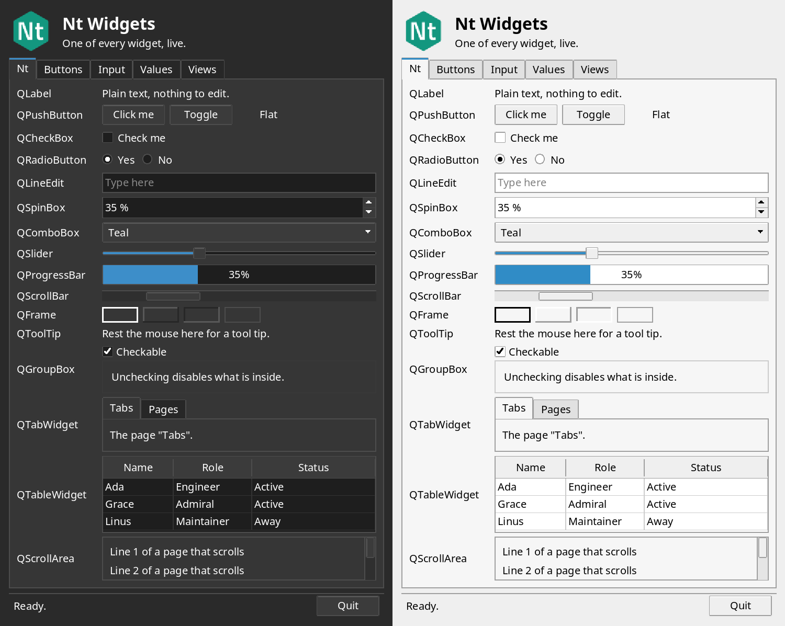

<p align="center"></p>

<p align="center"><a href="https://open-nt.github.io/Nt6/"></a></p>

<p align="center">

[](https://github.com/open-nt/Nt6/actions/workflows/ubuntu-22.04.yml)
[](https://github.com/open-nt/Nt6/actions/workflows/ubuntu-24.04.yml)
[](https://github.com/open-nt/Nt6/actions/workflows/ubuntu-26.04.yml)
[](https://github.com/open-nt/Nt6/actions/workflows/el9.yml)
[](https://github.com/open-nt/Nt6/actions/workflows/el10.yml)
[](https://github.com/open-nt/Nt6/actions/workflows/arch.yml)
[](https://github.com/open-nt/Nt6/actions/workflows/docs.yml)
[](https://slsa.dev)
[](https://snapcraft.io/open-nt6)

</p>

<p align="left"><a href="https://snapcraft.io/open-nt6"></a></p>

# Nt ("Nut")

**Write Qt. Ship MIT.** Nt is a small, MIT-licensed, clean-room implementation of the Qt 6 API in C++17. It keeps Qt's class names and headers (`QObject`, `<QtCore/QTimer>`, `QHttpServer`), so code written for Qt compiles against Nt, and it links statically by default.

- **MIT, all the way down.** The libraries and the tools (`ntmoc`, `ntrcc`, `ndoc`) are MIT licensed, so you can link Nt statically into any program, open or closed.
- **Source compatible.** `#include <QTimer>`, `Q_OBJECT`, `signals:`, `connect()` and the `Qt6::` CMake targets work as they do in Qt.
- **Built module by module.** `Nt Core`, `Nt Network`, `Nt Serial Port`, `Nt D-Bus`, `Nt HTTP Server`, `Nt WebSockets`, `Nt GUI`, `Nt Widgets`, `Nt SVG`, `Nt Concurrent` and `Nt Test` so far; [Status](#status) lists what each one has and what is missing.
- **Checked on every commit.** Tests run under AddressSanitizer, UBSan and ThreadSanitizer, and release packages carry SLSA level 3 provenance.

Nt is young: Core, Network, GUI and Widgets are partial, and it runs on Linux/POSIX only for now. It is not affiliated with The Qt Company, and no Qt source code is used.

**[Documentation](https://open-nt.github.io/Nt6/)** · **[Install](https://open-nt.github.io/Nt6/install.html)** · **[Examples](examples)** · **[Contributing](CONTRIBUTING.md)** · **[Discussions](https://github.com/open-nt/Nt6/discussions)**

## Quick start

A web service in one file, `main.cpp`:

```cpp
#include <QtCore>
#include <QtHttpServer>
#include <QtNetwork>

int main(int argc, char **argv) {
    QCoreApplication app(argc, argv);

    QHttpServer server;
    server.route("/hello/<arg>", [](const QString &name) { return QString("Hello, %1!\n").arg(name); });

    auto *tcp = new QTcpServer;
    if (!tcp->listen(QHostAddress::LocalHost, 8080) || !server.bind(tcp))
        return 1;
    return app.exec();
}
```

Its `CMakeLists.txt`:

```cmake
cmake_minimum_required(VERSION 3.18)
project(hello LANGUAGES CXX)
set(CMAKE_CXX_STANDARD 17)

find_package(Nt6 6 REQUIRED)

add_executable(hello main.cpp)
target_link_libraries(hello PRIVATE Nt6::HttpServer)
```

Build it, run it and call it:

```sh
cmake -S . -B build && cmake --build build
./build/hello &
curl http://127.0.0.1:8080/hello/Nt      # Hello, Nt!
```

Classes with `Q_OBJECT` need one more line, `nt_enable_automoc(hello)`; see [ntmoc](#ntmoc-mit-moc-replacement).

### Install

| System | Command |
|---|---|
| Ubuntu 22.04, 24.04, 26.04 | add the signed [apt repository](https://open-nt.github.io/Nt6/install.html), then `sudo apt install libnt6-dev nt6-tools` |
| Any Linux with snapd | `sudo snap install open-nt6 --channel=candidate` ([Snap Store](https://snapcraft.io/open-nt6); pass `-DCMAKE_PREFIX_PATH=/snap/open-nt6/current/usr` to CMake) |
| Enterprise Linux 9 and 10, Arch Linux | `.rpm` and pacman packages from the [releases](https://github.com/open-nt/Nt6/releases); see [Packages](#packages) |
| From source | `cmake -S . -B build && cmake --build build && sudo cmake --install build` |

Or use Nt without installing it: `add_subdirectory(Nt6)` in your project and link `Nt::HttpServer`.

### Widgets

Nt Widgets draws its own Fusion-like style, light and dark. This is [`hello_widgets`](examples/widgets/hello_widgets.cpp), one of every widget:

<p align="center"></p>

### More examples

| Example | Shows |
|---|---|
| [`examples/hello`](examples/hello) | a standalone project that uses an installed Nt |
| [`examples/signals`](examples/signals), [`examples/moc`](examples/moc) | signals and slots, and `ntmoc` |
| [`examples/httpserver`](examples/httpserver/hello_server.cpp) | routes, JSON, streaming, delayed answers and WebSockets on one port |
| [`examples/websockets`](examples/websockets), [`examples/dbus`](examples/dbus), [`examples/serialport`](examples/serialport) | an echo server and client, a clock on the session bus, serial ports |
| [`examples/gui`](examples/gui), [`examples/widgets`](examples/widgets), [`examples/svg`](examples/svg) | a painted window, the widget gallery, SVG rendering |

## Contents

- [Status](#status): what each module implements, and what it does not yet
- [Qt 6 modules and their Nt names](#qt-6-modules-and-their-nt-names)
- [ntmoc](#ntmoc-mit-moc-replacement), [ntrcc](#ntrcc-mit-rcc-replacement) and [NDoc](#ndoc-mit-documentation-generator): the tools
- [Build](#build) and [Packages](#packages)
- [Contributing](CONTRIBUTING.md), [Security](SECURITY.md) and the [Nt Brand Guide](https://open-nt.github.io/Nt6/brand.html) (artwork in [`assets/brand/`](assets/brand))

## Status

Qt Core has roughly 300 classes; Nt Core has about 180 of them, chosen first for what the other Nt modules need. **Nt Core is not complete.**

### Nt Core: implemented

| Area | Classes |
|---|---|
| Object model | `QObject` (parent/child, `connect`/`disconnect` for member slots, functors, context objects and `SIGNAL()`/`SLOT()` strings, `blockSignals`, `sender()`, `deleteLater()`, `destroyed`, `objectName`, `findChild(ren)`, timers, thread affinity), `QMetaObject::Connection`, `qobject_cast`, `Qt::ConnectionType` (`Auto`, `Direct`, `Queued`), `QFlags`, `qOverload`, `QObjectCleanupHandler`, `QSignalMapper` |
| Meta-objects and variants | `QMetaObject` (generated by `ntmoc`; `invokeMethod()` by name, pointer to member function or functor), `QMetaMethod`, `QMetaProperty`, `QMetaEnum`, `QMetaClassInfo`, `QMetaType`, `QVariant`, `QSequentialIterable`, `QAssociativeIterable`, `QTypeRevision`, `QPartialOrdering` |
| Events and loop | `QEvent`, `QTimerEvent`, `QDynamicPropertyChangeEvent`, `QEventLoop`, `QEventLoopLocker`, `QCoreApplication` (`exec`, `quit`, `postEvent`, `sendEvent`, `processEvents`, `aboutToQuit`, `qApp`), `QTimer` (incl. `singleShot`), `QSocketNotifier` (fd readiness via `poll()`) |
| Text and bytes | `QString` (UTF-16, `arg`, `split`, `number`, `toInt`/`toDouble`, UTF-8/Latin-1/UCS-4 conversion, Unicode normalization and full case mapping), `QChar` (Unicode 16 categories, scripts, bidi classes, joining types, mirroring and age), `QLatin1Char`, `QLatin1StringView`, `QStringView`, `QAnyStringView`, `QUtf8StringView`, `QStringConverter`/`QStringEncoder`/`QStringDecoder`, `QStringMatcher`, `QByteArrayMatcher`, `QStaticByteArrayMatcher`, `QLatin1StringMatcher`, `QStringTokenizer`, `QRegularExpression` (+ `QRegularExpressionMatch` and its iterator), `QLocale` (about thirty locales, no CLDR), `QCollator`, `QTextBoundaryFinder`, `QTranslator` (`.qm` files, with `tr()` and `QCoreApplication::installTranslator()`), `QByteArray` (hex, Base64, percent-encoding, number conversion), `QByteArrayView`, `QByteArrayList`, `QStringList`, `QTextStream` (UTF-8, UTF-16, UTF-32 and Latin-1, BOM detection) |
| Containers | `QList`/`QVector`, `QQueue`, `QStack`, `QMap`, `QMultiMap`, `QHash`, `QMultiHash`, `QSet`, `QVarLengthArray`, `QBitArray`, `QCache`, `QContiguousCache`, `QSpan`, `QKeyValueIterator` (with `asKeyValueRange()`), `qHash()`/`qHashRange()`/`qHashMulti()`, the Java-style iterators (`QListIterator`, `QMutableListIterator`, `QMapIterator`, `QMutableMapIterator`, `QHashIterator`, `QSetIterator`, ...) |
| Smart pointers | `QPointer`, `QScopedPointer`, `QScopedArrayPointer`, `QSharedPointer`, `QWeakPointer`, `QEnableSharedFromThis`, `QSharedData`, `QSharedDataPointer`, `QExplicitlySharedDataPointer`, `QScopeGuard`, `QScopedValueRollback`, `QSignalBlocker` |
| Threads | `QThread` (per-thread event loops and queued signals across threads), `QThreadPool`, `QRunnable`, `QThreadStorage`, `QException`, `QAtomicInt`, `QAtomicInteger`, `QAtomicPointer`, `QAtomicScopedValueRollback`, `QMutex`, `QRecursiveMutex`, `QMutexLocker`, `QReadWriteLock` (recursive or not), `QReadLocker`, `QWriteLocker`, `QWaitCondition` (with `QMutex` or `QReadWriteLock`), `QSemaphore`, `QSemaphoreReleaser`; deadline and `std::chrono` overloads |
| Futures | `QFuture`/`QFuture<void>` (state, results, iteration, progress, `cancel`, `suspend`/`resume`, exceptions, `then`/`onCanceled`/`onFailed` with a launch policy, thread pool or context object, `cancelChain`), `QPromise`, `QFutureInterface`, `QFutureWatcher` (signals through the watcher's event loop, pending-results limit), `QFutureSynchronizer`, `QtFuture::makeReady*`/`makeExceptionalFuture`/`connect`/`whenAll`/`whenAny`, `QAbstractEventDispatcher` (a handle onto the thread's dispatcher: timers, `wakeUp`, `interrupt`, `aboutToBlock`/`awake`; from `instance()`, `QThread::eventDispatcher()` or `QCoreApplication::eventDispatcher()`) |
| Time and diagnostics | `QElapsedTimer`, `QDeadlineTimer`, `QBasicTimer`, `QDate`, `QTime`, `QDateTime` (UTC, local time, fixed offsets and time zones), `QTimeZone` (the system's IANA database), `QCalendar` (Gregorian, Julian, Milanković, Jalali, Islamic civil), `QChronoTimer`, `QTimeLine`, `QEasingCurve`, `QDebug`, `QDebugStateSaver`, `qDebug()`/`qInfo()`/`qWarning()`/`qCritical()`/`qFatal()`, `qInstallMessageHandler`, `QMessageLogger`, `QLoggingCategory` |
| I/O and file system | `QIODevice` (with read transactions and read/write channels), `QIODeviceBase`, `QBuffer`, `QFileDevice`, `QFile` (permissions, file times, symbolic links), `QDataStream` (Qt's wire format, transactions), `QFileInfo`, `QDir`, `QDirIterator`, `QLockFile`, `QFileSystemWatcher` (inotify), `QSaveFile`, `QTemporaryFile`, `QTemporaryDir`, `QStandardPaths` (XDG), `QSettings` (INI), `QResource` (`:/` paths in `QFile`, `QFileInfo`, `QDir` and `QDirIterator`; resources compiled by `ntrcc`, compressed with Zstandard or zlib) |
| Processes and formats | `QProcess`, `QProcessEnvironment`, `QJsonValue`, `QJsonObject`, `QJsonArray`, `QJsonDocument`, `QXmlStreamReader` and `QXmlStreamWriter` (namespaces, entities of the internal DTD subset, incremental parsing, UTF-8/UTF-16/Latin-1) with `QXmlStreamAttributes` and the declaration classes |
| Animation | `QAbstractAnimation`, `QVariantAnimation` (key values, easing curves, `qRegisterAnimationInterpolator()`), `QPropertyAnimation`, `QPauseAnimation`, `QAnimationGroup`, `QSequentialAnimationGroup`, `QParallelAnimationGroup`; see also `QTimeLine` and `QEasingCurve` |
| Item models | `QAbstractItemModel`, `QAbstractListModel`, `QAbstractTableModel`, `QModelIndex`, `QPersistentModelIndex`, `QStringListModel`, `QItemSelectionModel`, `QItemSelection`, `QItemSelectionRange`, `QAbstractProxyModel`, `QIdentityProxyModel`, `QSortFilterProxyModel` (filtering, sorting, recursive filtering), `QTransposeProxyModel`, `QConcatenateTablesProxyModel`, `QMimeData` |
| Geometry | `QPoint`/`QPointF`, `QSize`/`QSizeF`, `QRect`/`QRectF`, `QLine`/`QLineF`, `QMargins`/`QMarginsF` |
| Utilities | `QUrl` (`fromUserInput()`, internationalized host names in Punycode) and `QUrlQuery`, `QUuid`, `QVersionNumber`, `QRandomGenerator`, `QCryptographicHash` (MD4, MD5, SHA-1, SHA-2, SHA-3, Keccak, BLAKE2b, BLAKE2s), `QMessageAuthenticationCode`, `QCommandLineParser`, `QCommandLineOption`, `QSysInfo`, `QOperatingSystemVersion`, `QLibraryInfo`, `QLibrary`, `QSharedMemory` and `QSystemSemaphore` (POSIX shared memory and named semaphores), `QGlobalStatic`, `QApplicationStatic` (`Q_APPLICATION_STATIC()`), `qfloat16`, `QBEInteger`/`QLEInteger` |
| Global functions and macros | the environment (`qgetenv()`, `qputenv()`, `qEnvironmentVariable()` and the rest), `<QtMath>` (`qSin()`, `qDegreesToRadians()`, `qNextPowerOfTwo()`, `M_PI`), `<QtNumeric>` (`qIsNaN()`, `qInf()`, `qFloatDistance()`, `qAddOverflow()`), `<QtAlgorithms>` (`qPopulationCount()`, `qCountTrailingZeroBits()`), `qAsConst()`, `qExchange()`, `qDeleteAll()`, `qMakePair()`, `qToUnderlying()`, the C string functions (`qstrcmp()`, `qstricmp()`, `qstrncpy()`, ...), `qCompress()`/`qUncompress()` (with zlib), `qAppName()`, `qErrnoWarning()`, `qAddPostRoutine()` and `Q_COREAPP_STARTUP_FUNCTION()`, `Q_UNREACHABLE()`, `Q_ASSUME()`, `Q_ASSERT_X()`, `Q_CHECK_PTR()`, `Q_FALLTHROUGH()`, `Q_DISABLE_COPY_MOVE()`, `Q_DECLARE_INTERFACE()`, `Q_DECLARE_TYPEINFO()`, `Q_STATIC_LOGGING_CATEGORY()` and the `Q_DECL_*` keywords |

Known limits: `QDataStream` has no 64-bit container sizes; `QDir` name filters are case-insensitive; `QTimeZone` has no localized names (no CLDR/ICU); `QList<bool>` is rejected at compile time; no bindable properties (`QProperty`). Each class's reference page lists how it differs from Qt.

### Nt Core: not implemented yet

- **Meta:** `QProperty` and bindable properties
- **Plugins:** `QPluginLoader`, `Q_PLUGIN_METADATA`
- **Formats:** `QCbor*`, `QMimeDatabase`/`QMimeType`
- **Concurrency:** `QFutureIterator`, custom event dispatchers (`QThread::setEventDispatcher()`) and native event filters; QtConcurrent is in Nt Concurrent, below
- **Item models:** `QRangeModel`
- **System and misc:** permission classes, JNI and Windows-only classes

### Nt Network: implemented

| Class | Notes |
|---|---|
| `QHostAddress` | IPv4/IPv6 parse and format, special addresses (`Any` is dual-stack), `isEqual` with conversion modes, loopback/multicast/link-local/global checks |
| `QAbstractSocket` | state machine, `connectToHost` (IP or name), `bind`, `disconnectFromHost` (flushes pending writes first), buffered async I/O through the event loop, `waitFor*` blocking API, read-buffer limit, socket options, `errorOccurred`, `stateChanged`, `hostFound` |
| `QTcpSocket` | client and accepted-connection sockets |
| `QTcpServer` | `listen`, `newConnection`, `nextPendingConnection`, `waitForNewConnection`, pause/resume accepting, pending-connection limit |
| `QUdpSocket` | `bind`, `writeDatagram`, `readDatagram`, `receiveDatagram`, connected mode, IPv4/IPv6 multicast join/leave |
| `QNetworkDatagram` | data, sender, destination, `makeReply` |
| `QHostInfo` | blocking `fromName`, asynchronous `lookupHost` (functor, with optional context object), `abortHostLookup`, local host and domain names |
| `QNetworkInterface`, `QNetworkAddressEntry` | list interfaces, flags, type, MTU, hardware address, addresses, netmask, broadcast (Linux) |
| `QSslSocket`, `QSslServer`, `QSslConfiguration`, `QSslCertificate`, `QSslKey`, `QSslCipher`, `QSslError` | TLS with the system's OpenSSL (built when OpenSSL 1.1.1 or newer is found, `-DNT_USE_OPENSSL=OFF` to leave it out); `https:` in `QNetworkAccessManager` |
| `QLocalSocket`, `QLocalServer` | Unix domain sockets: event-driven and `waitFor*` APIs, access options, stale-socket recovery |
| `QHttpHeaders` | ordered, case-insensitive header fields; names and values are validated, so CR/LF cannot be injected |
| `QNetworkAccessManager`, `QNetworkRequest`, `QNetworkReply` | HTTP/1.1 client: `GET`/`HEAD`/`POST`/`PUT`/`DELETE`/custom verbs, chunked and fixed-length bodies, redirects with policies, inactivity timeouts, Basic auth from the URL |

Differences from Qt: `QAbstractSocket::connectToHost` resolves names synchronously, although `QNetworkAccessManager` and `QHostInfo::lookupHost` do not block; `QUdpSocket` does not report the destination address or hop limit of received datagrams.

### Nt Network: not implemented yet

`QDnsLookup`, `QNetworkProxy`, DTLS, `QSctpSocket`, `QAuthenticator`, `QNetworkCookie`/`QNetworkCookieJar`, `QHttpMultiPart`, HTTP/2, connection reuse and response compression.

### Nt D-Bus: implemented

Nt D-Bus implements the D-Bus wire protocol itself (no libdbus) and works with `dbus-daemon`, `dbus-broker`, GDBus and sd-bus peers.

| Class | Notes |
|---|---|
| `QDBusConnection` | session, system and activation buses, named connections, peer-to-peer, blocking (`Block`, `BlockWithGui`), asynchronous and callback calls, `registerObject` with all export options and child objects, `registerVirtualObject`, `registerService`, signal connections with argument and signature matching; thread-safe, with one I/O thread for all connections |
| `QDBusAbstractAdaptor`, `QDBusContext`, `QDBusVirtualObject` | exported interfaces with automatic signal relay, delayed and error replies, objects that handle whole sub-trees; `Introspectable`, `Properties` and `Peer` are answered for every object |
| `QDBusAbstractInterface`, `QDBusInterface`, `QDBusConnectionInterface` | proxies with typed methods and relayed signals, remote properties, argument conversion from introspection data, the bus daemon's own interface |
| `QDBusMessage`, `QDBusArgument`, `QDBusMetaType`, `QDBusVariant`, `QDBusObjectPath`, `QDBusSignature`, `QDBusUnixFileDescriptor`, `QDBusError` | the full type system including structures, maps, variants and file-descriptor passing; custom types with `qDBusRegisterMetaType`; every received message is validated |
| `QDBusReply`, `QDBusPendingCall`, `QDBusPendingCallWatcher`, `QDBusPendingReply` | typed replies with signature checks; `QDBusPendingReply` is variadic |
| `QDBusServer`, `QDBusServiceWatcher` | a peer-to-peer server (`EXTERNAL`, optional `ANONYMOUS`), watching names including `org.example.*` wildcards |

Guide: [Using Nt D-Bus](https://open-nt.github.io/Nt6/nt-dbus.html). The [`dbus_clock`](examples/dbus/clock.cpp) example exports a clock on the session bus (`dbus_clock server`) and calls it (`dbus_clock client`).

Differences from Qt: only `unix:` addresses (no `tcp:`, `nonce-tcp:` or `autolaunch:`), and no `DBUS_COOKIE_SHA1` authentication; `QDBusInterface` has no meta-object built from introspection, so connect to remote signals with `QDBusConnection::connect()`; no `qdbusxml2cpp`, `qdbuscpp2xml`, `qdbus` or `qdbusviewer` tools.

### Nt HTTP Server: implemented

Nt HTTP Server is an HTTP/1.1 server for embedding in an application, on top of Nt Network.

| Class | Notes |
|---|---|
| `QHttpServer` | routes with typed path arguments (`/user/<arg>` → `int`, `QString`, `QByteArray`, `double`, `QUrl`, ...), method filters, context objects and member-function slots, after-request handlers, a missing handler |
| `QAbstractHttpServer` | serves any number of `QTcpServer`, `QSslServer` (HTTPS) and `QLocalServer` objects; persistent connections, pipelining, chunked request bodies, `Expect: 100-continue`; malformed or oversized requests are refused, and requests with both `Transfer-Encoding` and `Content-Length` are rejected |
| `QHttpServerRequest`, `QHttpServerResponse`, `QHttpServerResponder` | the request with its absolute URL, headers and body; responses from strings, JSON, bytes or files; writing through the responder, including chunked bodies with trailers, streaming a `QIODevice`, and answering later |
| `QHttpServerRouterRule` | the rule a route returns |
| `QHttpServerWebSocketUpgradeResponse` | WebSocket upgrades on the server's own port: verifiers accept, deny or pass each upgrade request, and accepted connections arrive through `newWebSocketConnection()` as `QWebSocket`s |

Guide: [Using Nt HTTP Server](https://open-nt.github.io/Nt6/nt-httpserver.html). The [`hello_server`](examples/httpserver/hello_server.cpp) example is a small web service with JSON, streaming and delayed answers.

```cpp
QHttpServer server;
server.route("/hello/<arg>", [](const QString &name) { return "Hello, " + name; });
auto *tcp = new QTcpServer;
tcp->listen(QHostAddress::Any, 8080);
server.bind(tcp);
```

Differences from Qt: no HTTP/2, no WebSocket upgrades on a `QLocalServer`, no `QHttpServerConfiguration` (rate limits, keep-alive timeout, address filters) and no idle timeout; no `router()`, custom rules or converters; handlers cannot return a `QFuture`; the request size limits are fixed (8 KiB request line, 64 KiB of header fields, 64 MiB body); `QHttpHeaders` takes `QByteArrayView` rather than `QAnyStringView` and knows the common header names only.

### Nt WebSockets: implemented

Nt WebSockets implements the WebSocket protocol (RFC 6455) itself, on top of Nt Network, and interoperates with browsers and other implementations (tested against Python's `websockets`).

| Class | Notes |
|---|---|
| `QWebSocket` | client (`ws:` and `wss:`) and server side; text and binary messages, frame-by-frame signals, fragmentation of large messages, ping/pong with round-trip time, the closing handshake with codes and reasons, size limits on incoming frames and messages, custom request headers, TLS settings |
| `QWebSocketServer` | `ws:` and `wss:` (`SecureMode`) servers; every opening handshake is checked (426 for other versions), handshake timeout, a limit on pending connections, `handleConnection()` for sockets accepted elsewhere |
| `QWebSocketCorsAuthenticator`, `QWebSocketHandshakeOptions`, `QMaskGenerator`, `QWebSocketProtocol` | origin checks, subprotocol negotiation, custom masking keys, versions and close codes |

Every frame from the peer is validated: masking, reserved bits and opcodes, control-frame rules, fragmentation, UTF-8 of text (also across frames) and close codes; a peer that breaks the protocol is sent the matching close code and disconnected. Nt HTTP Server can also accept upgrades on its own port.

Guide: [Using Nt WebSockets](https://open-nt.github.io/Nt6/nt-websockets.html). The [`websocket_echo`](examples/websockets/echo.cpp) example is an echo server (`websocket_echo server`) and a client for it (`websocket_echo client ws://127.0.0.1:1234 hello`).

```cpp
QWebSocket socket;
QObject::connect(&socket, &QWebSocket::connected, [&] { socket.sendTextMessage("hello"); });
QObject::connect(&socket, &QWebSocket::textMessageReceived, [](const QString &reply) { qDebug() << reply; });
socket.open(QUrl("ws://127.0.0.1:1234"));
```

Differences from Qt: no extensions (so no `permessage-deflate` compression), no proxies, only version 13 of the protocol, no timeout for a client's opening handshake, and frames are received whole before they are reported; incoming frames and messages are limited to 64 MiB by default (1 GiB at most).

```cpp
QTcpServer server;
server.listen(QHostAddress::LocalHost, 0);
QObject::connect(&server, &QTcpServer::newConnection, [&] {
    QTcpSocket *s = server.nextPendingConnection();
    QObject::connect(s, &QIODevice::readyRead, [s] { s->write(s->readAll().toUpper()); });
});
```

Header names match Qt: `#include <QObject>`, `#include <QtCore/QTimer>`, `#include <QtNetwork/QTcpSocket>`, `#include <QtCore/qobject.h>`.

### Nt GUI: implemented

Nt GUI is layered like Qt GUI: a `QGuiApplication` loads a platform integration (QPA), which creates the windows and delivers input. The platforms are `xcb` (X11, including XWayland) and `offscreen` (no display, for tests); pick one with `-platform` or `QT_QPA_PLATFORM`.

| Class | Notes |
|---|---|
| `QGuiApplication`, `QScreen` | platform selection, screens, focus window, keyboard modifiers and mouse buttons, `quitOnLastWindowClosed` |
| `QWindow`, `QBackingStore` | top-level windows: geometry, title, show/hide/close, expose, `requestUpdate`, mouse, wheel, key, focus, enter/leave, move, resize and close events |
| `QPaintDeviceWindow`, `QRasterWindow` | windows you paint on with `QPainter`, repainted from the event loop |
| `QPainter`, `QPaintDevice`, `QPaintEngine` | software raster engine: pen, brush, opacity, clipping, translation, composition modes; rectangles, lines, points, ellipses, images and text, without antialiasing of shapes |
| `QFont`, `QFontMetrics` | families found with fontconfig, point or pixel size, weight, italic; metrics, `elidedText()`, `drawText()` with alignment, word wrap and clipping; glyphs are anti-aliased by FreeType |
| `QImage`, `QColor`, `QRgb`, `QPen`, `QBrush`, `QRegion` | 32-bit images (`RGB32`, `ARGB32`, `ARGB32_Premultiplied`) with implicit sharing, colors with `#rgb` and CSS names, solid pens and brushes, rectangle-list regions |
| `QAction`, `QActionGroup`, `QKeySequence`, `QActionEvent` | what a user can do, shared by menus and shortcuts: text, check state, enabled and visible, a shortcut (a key with modifiers, from a string or a standard key), exclusive groups, and the events for widgets that show actions. No icons, and one key per sequence |
| `QMouseEvent`, `QWheelEvent`, `QKeyEvent`, `QFocusEvent`, `QEnterEvent`, `QPaintEvent`, `QExposeEvent`, `QResizeEvent`, `QMoveEvent`, `QShowEvent`, `QHideEvent`, `QCloseEvent` | the event classes, with the `Qt::Key`, `Qt::MouseButton` and `Qt::KeyboardModifier` enums |

Guide: [Using Nt GUI](https://open-nt.github.io/Nt6/nt-gui.html). The [`hello_window`](examples/gui/hello_window.cpp) example paints a window and follows the mouse.

Not implemented yet: text shaping (HarfBuzz) and font fallback, `QFontDatabase`, `QTextLayout`, image files (a `QPixmap` is painted in memory, not loaded), `QTransform`, paths and gradients, antialiasing, the clipboard, cursors, RandR multi-screen, and Wayland.

### Nt Widgets: implemented

Nt Widgets builds on Nt GUI. The widgets of a window are painted into the backing store of one native window, so only top-level widgets are `QWindow`s.

| Class | Notes |
|---|---|
| `QApplication` | the style, the default palette, top-level widgets, `activeWindow()`, `focusWidget()`, `closeAllWindows()` |
| `QWidget` | parent/child tree, windows with a parent (`Qt::Window`, `Qt::Dialog`, `Qt::Tool`) that the window manager keeps above it, application- and window-modal windows that block the input of the others, geometry and size limits, size hints and policies, show/hide/enable, palette and font inheritance, painting with `update()`/`repaint()`, mouse (grab, enter/leave, tracking), wheel, key and focus events with propagation to the parent, click and tab focus, `mapTo*()`, `childAt()`, `raise()`/`lower()`, layouts |
| `QLayout`, `QBoxLayout`, `QHBoxLayout`, `QVBoxLayout`, `QLayoutItem`, `QWidgetItem`, `QSpacerItem` | box layouts with stretch factors, spacing, margins, nested layouts, alignment across the box, reversed directions, stretches and spacers; laid out again from the event loop when a size hint changes |
| `QSizePolicy` | the Qt policies |
| `QLabel`, `QPushButton`, `QCheckBox`, `QRadioButton`, `QAbstractButton`, `QButtonGroup` | text with alignment and word wrap; clicked/pressed/released/toggled, checkable and flat buttons, mouse and Space handling, default and auto-default buttons for Return; radio buttons that share a parent are exclusive, and the arrow keys move the choice; button groups with ids that make buttons exclusive across parents |
| `QLineEdit` | one line of text: typing, cursor and selection with keys and mouse, placeholder, password and no-echo modes, maximum length, read-only, `textChanged`/`textEdited`/`returnPressed`/`editingFinished` |
| `QAbstractSlider`, `QSlider`, `QProgressBar`, `QAbstractSpinBox`, `QSpinBox`, `QDoubleSpinBox` | a base class with the range, tracking, `triggerAction()` and inverted controls; a handle to drag (click for a page, keys, wheel, horizontal or vertical); a bar with a text format (`%p`, `%v`, `%m`); an integer or a floating-point number with decimals to type or step, with a prefix, a suffix, wrapping, a special value text, read-only and keyboard tracking |
| `QComboBox` | items to choose from a list that drops down inside the window, above or below the box; keys and wheel change the item without opening it |
| `QGroupBox`, `QTabWidget`, `QTabBar`, `QToolBox` | a titled frame, optionally with a check box that enables its children; pages with a row of tabs that can have close buttons, tool tips and be dragged into another order; a column of items of which one is open |
| `QDateTimeEdit`, `QDateEdit`, `QTimeEdit`, `QCalendarWidget` | dates and times in a display format of sections that the keys and buttons step, typed or picked from a calendar popup, within a range; a month calendar with week numbers, keys and a date range |
| `QCompleter`, `QKeySequenceEdit`, `QFontComboBox`, `QCommandLinkButton` | completion of a line edit from a list of words, in a popup or inline; a shortcut recorder; the fontconfig families in a combo box; a large flat button with a description |
| `QMdiArea`, `QMdiSubWindow` | sub-windows inside an area that the user moves by the title bar, resizes by the edges, minimizes, maximizes and closes; tiling, cascading, activation order, and a tabbed view |
| `QTextBrowser`, `QSplashScreen`, `QRubberBand`, `QFocusFrame`, `QWidgetAction` | a read-only viewer of text files with backward/forward history and search paths; a splash screen with a pixmap and messages that closes when the main window shows; a selection rectangle or line; a frame that follows a widget; actions that put a widget in a tool bar |
| `QGridLayout` | a grid of rows and columns with spans, stretch factors, minimum sizes, alignment and separate horizontal and vertical spacing; shares its algorithm with the box layouts, so the sizes match Qt's |
| `QFormLayout`, `QStackedLayout`, `QStackedWidget` | a form of labels and fields with the Fusion defaults (growing fields, labels on the left), wrapping of rows, row insertion and removal; pages of which one is shown, with `currentChanged`/`widgetRemoved` |
| `QFrame`, `QScrollBar`, `QAbstractScrollArea`, `QScrollArea` | box, panel, line and styled frames with a shadow; a scroll bar (handle, page click, wheel); a base class with a viewport, two scroll bars and margins; a scrolling view of a widget, resizable or not, with `ensureVisible()` |
| `QPlainTextEdit`, `QTextEdit`, `QTextCursor` | plain text of many lines: typing, the arrow, Page, Home and End keys with words and Shift, mouse and double-click selection, wrapping or not, tab stops, undo and redo, read-only, a placeholder, `appendPlainText()` that follows the end of a log; a cursor that moves by characters, words, lines and blocks, selects and edits, with edit blocks. No rich text and no clipboard yet |
| `QListWidget`, `QListWidgetItem`, `QAbstractItemView` | a list of text items with single, multi, extended (Control and Shift) and no selection, keys (arrows, Page, Home, End, Space, Return, type-ahead), sorting, colors, alignment, tool tips and scrolling; the base class has the selection mode and the alternating row colors that the table shares |
| `QMenu`, `QMenuBar`, `QWidget::addAction()` | popup menus inside the window (a menu is a child widget, so it never leaves the window): entries with mnemonics, shortcuts, check boxes, separators and submenus that open on hover; keys (arrows, Return, Space, Escape, letters), `popup()` and a blocking `exec()`; a menu bar with menus that switch while one is open, Left and Right between them, and Alt+letter. A shortcut of an action works anywhere in the window it was added to. No icons, tear-off or scrolling menus |
| `QMainWindow`, `QToolBar`, `QDockWidget`, `QSizeGrip` | a main window with a menu bar, rows and columns of tool bars, dock widgets around the central widget and a status bar; tool bars of buttons for actions, separators and widgets, with toggle view actions; dock widgets with a title bar that close and float as windows above the main window; a grip that resizes its window. Tool bars and dock widgets cannot be dragged |
| `QDialog`, `QDialogButtonBox`, `QMessageBox`, `QInputDialog`, `QProgressDialog`, `QErrorMessage` | dialogs that are windows above their parent, centered on it, with `exec()`, `open()`, Escape and default buttons; buttons in the order of the platform by role; message boxes with drawn icons, informative and detailed text, a check box and the static `question()`/`warning()`/...; input of a text, an item or a number; progress that shows after a delay and can be canceled; error messages that the user can silence |
| `QFileDialog`, `QColorDialog`, `QFontDialog`, `QWizard`, `QWizardPage` | a file dialog drawn by Nt for opening files, saving with overwrite confirmation and choosing directories, with name filters; colors from a grid, a hue and saturation field, HSV/RGB/alpha and HTML; fonts from the fontconfig families with styles and sizes; wizards with pages, fields (mandatory ones too), commit pages and the Back/Next/Finish buttons |
| `QToolButton`, `QDial`, `QLCDNumber`, `QSplitter`, `QStatusBar` | a tool button with text or an arrow, checkable, flat with `autoRaise`; a dial with notches and wrapping; a seven-segment display in decimal, hex, octal and binary with three segment styles; a splitter with draggable handles, collapsible and stretching panes, as many panes as there are; a status bar with a temporary message, and widgets on the left and permanent ones on the right |
| `QTableWidget`, `QTableWidgetItem`, `QHeaderView` | a table of items with text, alignment, colors, font and a tool tip; row and column headers whose sections the user can resize; a current cell (click and keys), scrolling, alternating row colors, grid lines, inserting and removing rows and columns |
| `QToolTip`, `QHelpEvent`, `QWidget::setToolTip()` | tool tips that appear after the mouse rests, follow the widget under the mouse, and show the text of the nearest widget that has one; `QEvent::ToolTip` for tool tips that depend on the position |
| `QStyle`, `QStyleOption` and its subclasses, `QPalette` | a Fusion-like default style behind `QStyle`, with a light and a dark palette, replaceable with `QApplication::setStyle()` |

Guide: [Using Nt Widgets](https://open-nt.github.io/Nt6/nt-widgets.html). The [`hello_widgets`](examples/widgets/hello_widgets.cpp) example has the Nt logo, an SVG resource shown by a `QSvgWidget`, and one of every widget on the pages of a tab widget (its first page, *Nt*, is a showcase of all the widgets, live, and the *Views* page has a table and a scroll area), and [`gallery`](examples/widgets/gallery.cpp) shows more: custom widgets, a dark theme, enabling groups of controls, and the same logo.

<p align="center">  </p>
<p align="center"> </p>

The examples follow the desktop: it uses twice as many pixels on a high-resolution screen (`QScreen::devicePixelRatio()`, from `Xft.dpi` or `QT_SCALE_FACTOR`) and the dark or light colors of the desktop (`QStyleHints::colorScheme()`, read from the desktop portal). The widget examples use only API that Qt has too, so `-DNT_EXAMPLES_QT=ON` also builds them against Qt 6 (`hello_widgets_qt`, `gallery_qt` in `qt-examples/`) to compare the two side by side.

Not implemented yet: rich text and the clipboard, the model/view classes (trees, editing and sorting by the user), native dialogs, dragging tool bars and dock widgets, window attributes, cursors, `QStyleFactory`, style sheets.

## Qt 6 modules and their Nt names

The library is called **Nt**, not Qt: modules are `Nt Core`, `Nt Network`, and so on, and CMake targets are `Nt::<Module>` (`Nt::Core`, `Nt::Network`, `Nt::SerialPort`, `Nt::DBus`, `Nt::HttpServer`, `Nt::WebSockets`, `Nt::Gui`, `Nt::Widgets`, `Nt::Svg`, `Nt::SvgWidgets`, `Nt::Concurrent` and `Nt::Test` today). The C++ API keeps Qt's class names and headers (`QObject`, `<QtCore/QTimer>`) so Qt code compiles unchanged; `Qt6::Core` remains as an alias of `Nt::Core`.

✔ = Nt has a version (partial unless noted). Blank = not started. Module list checked against the Qt 6 module overview.

### Nt Concurrent: implemented

Nt Concurrent runs functions in the threads of a `QThreadPool` and returns a `QFuture` for what they produce.

| Function | Notes |
|---|---|
| `QtConcurrent::run()` | a function, member function or function object with its arguments, in the global pool or a given one; a function that takes a `QPromise<T> &` first reports several results and progress and can be canceled and suspended |
| `QtConcurrent::task()` | `QTaskBuilder`: `withArguments()`, `onThreadPool()`, `withPriority()`, `spawn()` |
| `map()`, `mapped()`, `mappedReduced()` | on a sequence or a pair of iterators; results in the order of the items; `ReduceOptions` (`UnorderedReduce`, `OrderedReduce`, `SequentialReduce`), initial values, result type named or taken from the reduce function |
| `filter()`, `filtered()`, `filteredReduced()` | the same forms for keeping items |
| `blocking...()` | every map and filter function, run in the pool and the calling thread |

The futures of the map and filter functions report progress, can be canceled and suspended, and rethrow the first exception. Link with `Nt::Concurrent` (or `Qt6::Concurrent`) and include `<QtConcurrent>`.

```cpp
QFuture<QString> text = QtConcurrent::run(readFile, path);
int words = QtConcurrent::blockingMappedReduced(files, countWords, [](int &total, int n) { total += n; });
```

Differences from Qt: items are handed out in blocks of a fixed size rather than an adaptive one; waiting for a non-blocking map from a thread of a saturated pool does not lend that thread to the pool (the `blocking` functions do work there); results of type `bool` cannot be read from a `QFuture`.

### Nt SVG: implemented

Nt SVG reads SVG documents and draws them with a `QPainter`, and writes what a painter draws as SVG. The XML reader and the antialiased rasterizer are its own: shapes are filled and stroked at the resolution of the device, whatever the painter can do itself. `Nt::Svg` needs only Nt GUI; `Nt::SvgWidgets` adds the widget.

| Class | Notes |
|---|---|
| `QSvgRenderer` | loads from a file, a resource or a `QByteArray`; draws the document, or one element by its `id`, into any rectangle of any paint device; default size, view box, aspect ratio modes, `boundsOnElement()`, `elementExists()` |
| `QSvgGenerator` | a paint device that writes rectangles, lines, points and ellipses as SVG elements and images as embedded PNG, to a file or a `QIODevice`; title, description, size, view box, resolution; SVG Tiny 1.2 or SVG 1.1 (with clipping) |
| `QSvgWidget` | shows a document scaled to the widget |

Drawn: `svg`, `g`, `defs`, `symbol`, `use`, `a`, `switch`; `path` (all commands, arcs included), `rect`, `circle`, `ellipse`, `line`, `polyline`, `polygon`; `text` and `tspan`; linear and radial gradients (units, transformations, spread methods, focal point, references); `clipPath`; fills and strokes with opacity, both fill rules, caps, joins, miter limits and dashes; group opacity; transformations; lengths with units; properties from attributes, `style` attributes and `<style>` sheets (element, class and id selectors).

Documents are treated as untrusted input: loading reads only the bytes it is given, nesting and references have a fixed depth, and one drawing visits a bounded number of elements (`QtSvg::AssumeTrustedSource` lifts that limit).

Guide: [Using Nt SVG](https://open-nt.github.io/Nt6/nt-svg.html). The [`svg_viewer`](examples/svg/svg_viewer.cpp) example shows a file in a window and writes one with `QSvgGenerator`.

```cpp
QSvgRenderer renderer(QString(":/logo.svg"));
QImage image(256, 256, QImage::Format_ARGB32_Premultiplied);
image.fill(Qt::transparent);
QPainter painter(&image);
renderer.render(&painter);
```

Differences from Qt: static documents only (no SMIL or CSS animation); no `image`, `mask`, `pattern`, `marker`, filters or `textPath`; text is drawn upright in one color with system fonts, following position and scale but not rotation; `preserveAspectRatio` is not read (use `setAspectRatioMode()`); no `load(QXmlStreamReader *)`, `transformForElement()` or `QGraphicsSvgItem`. `QSvgGenerator` writes text as an image of its glyphs, not as `text` elements.

### Essentials

| Qt module | Nt library | Done |
|---|---|---|
| Qt Core | Nt Core | ✔ (partial, see Status) |
| Qt D-Bus | Nt D-Bus | ✔ (see Status) |
| Qt GUI | Nt GUI | ✔ (partial, see Status) |
| Qt Network | Nt Network | ✔ (partial, see Status) |
| Qt Qml | Nt Qml |  |
| Qt Qml Core | Nt Qml Core |  |
| Qt Qml WorkerScript | Nt Qml WorkerScript |  |
| Qt Qml Models | Nt Qml Models |  |
| Qt Quick | Nt Quick |  |
| Qt Quick Controls | Nt Quick Controls |  |
| Qt Quick Dialogs | Nt Quick Dialogs |  |
| Qt Quick Layouts | Nt Quick Layouts |  |
| Qt Quick Test | Nt Quick Test |  |
| Qt Test | Nt Test | ✔ |
| Qt Widgets | Nt Widgets | ✔ (partial, see Status) |

### Add-ons

| Qt module | Nt library | Done |
|---|---|---|
| Qt Active Qt | Nt Active Qt |  |
| Qt Bluetooth | Nt Bluetooth |  |
| Qt Canvas Painter | Nt Canvas Painter |  |
| Qt CoAP | Nt CoAP |  |
| Qt Concurrent | Nt Concurrent | ✔ |
| Qt Graphs | Nt Graphs |  |
| Qt GRPC | Nt GRPC |  |
| Qt Help | Nt Help |  |
| Qt HTTP Server | Nt HTTP Server | ✔ (see Status) |
| Qt Image Formats | Nt Image Formats |  |
| Qt Lottie Animation | Nt Lottie Animation |  |
| Qt MQTT | Nt MQTT |  |
| Qt Multimedia | Nt Multimedia |  |
| Qt Network Authorization | Nt Network Authorization |  |
| Qt NFC | Nt NFC |  |
| Qt OPC UA | Nt OPC UA |  |
| Qt OpenGL | Nt OpenGL |  |
| Qt Positioning | Nt Positioning |  |
| Qt Print Support | Nt Print Support |  |
| Qt Protobuf | Nt Protobuf |  |
| Qt Qml Compiler | Nt Qml Compiler |  |
| Qt Qml Design Support | Nt Qml Design Support |  |
| Qt Qml Network | Nt Qml Network |  |
| Qt Qml XmlListModel | Nt Qml XmlListModel |  |
| Qt Quick 3D | Nt Quick 3D |  |
| Qt Quick 3D Physics | Nt Quick 3D Physics |  |
| Qt Quick Effects | Nt Quick Effects |  |
| Qt Quick Particles | Nt Quick Particles |  |
| Qt Quick Timeline | Nt Quick Timeline |  |
| Qt Quick Widgets | Nt Quick Widgets |  |
| Qt Remote Objects | Nt Remote Objects |  |
| Qt SCXML | Nt SCXML |  |
| Qt Sensors | Nt Sensors |  |
| Qt Serial Bus | Nt Serial Bus |  |
| Qt Serial Port | Nt Serial Port | ✔ |
| Qt Shader Tools | Nt Shader Tools |  |
| Qt Spatial Audio | Nt Spatial Audio |  |
| Qt SQL | Nt SQL |  |
| Qt State Machine | Nt State Machine |  |
| Qt SVG | Nt SVG | ✔ (see Status) |
| Qt TextToSpeech | Nt TextToSpeech |  |
| Qt UI Tools | Nt UI Tools |  |
| Qt Virtual Keyboard | Nt Virtual Keyboard |  |
| Qt Wayland Compositor | Nt Wayland Compositor |  |
| Qt WebChannel | Nt WebChannel |  |
| Qt WebSockets | Nt WebSockets | ✔ (see Status) |
| Qt WebView | Nt WebView |  |
| Qt XML | Nt XML |  |
| Qt 5 Compatibility APIs: Graphical Effects | Nt 5 Compatibility APIs: Graphical Effects |  |
| Qt 5 Core Compatibility APIs | Nt 5 Core Compatibility APIs |  |

### Add-ons in technology preview

| Qt module | Nt library | Done |
|---|---|---|
| Qt Labs Platform | Nt Labs Platform |  |
| Qt Labs StyleKit | Nt Labs StyleKit |  |
| Qt Location | Nt Location |  |
| Qt OpenAPI | Nt OpenAPI |  |
| Qt TaskTree | Nt TaskTree |  |

### Deprecated add-ons

| Qt module | Nt library | Done |
|---|---|---|
| Qt 3D | Nt 3D |  |
| Qt Charts | Nt Charts |  |
| Qt Data Visualization | Nt Data Visualization |  |

### Extension modules

| Qt module | Nt library | Done |
|---|---|---|
| Qt PDF | Nt PDF |  |
| Qt WebEngine | Nt WebEngine |  |

### Commercial modules

| Qt module | Nt library | Done |
|---|---|---|
| Qt Insight Tracker | Nt Insight Tracker |  |
| Qt VNC Server | Nt VNC Server |  |

## ntmoc: MIT moc replacement

Qt's moc is not used. `ntmoc` (`tools/ntmoc`) is a small MIT scanner that generates the bodies of signals declared without one:

```cpp
class Counter : public QObject {
    Q_OBJECT
public:
    void setValue(int v) { emit valueChanged(v); }
signals:
    void valueChanged(int value);   // body generated by ntmoc
};
```

It handles namespaces, nested classes, overloaded signals (use `qOverload`), default arguments and unnamed parameters. Signals with a hand-written body (`{ emitSignal(&Counter::valueChanged, value); }`) also work without ntmoc. Limitations: classes must have `Q_OBJECT`; signals of template classes are not supported; parameter names are guessed by a heuristic, not a C++ parser.

### CMake

AUTOMOC, driven by ntmoc (see `examples/moc`):

```cmake
add_subdirectory(Nt6)                      # or include Nt's CMakeLists.txt
add_executable(app main.cpp counter.h)
target_link_libraries(app PRIVATE Nt::Core)
nt_enable_automoc(app)                     # sets AUTOMOC and AUTOMOC_EXECUTABLE
```

Explicit form, like `qt_wrap_cpp`:

```cmake
nt_wrap_cpp(moc_sources counter.h)
add_executable(app main.cpp ${moc_sources})
```

ntmoc also accepts the moc command line CMake's AUTOMOC uses (`-o`, `-I`, `-D`, `@file`, `--output-dep-file`, `--version`), and is available as `Nt::moc` (and `Qt6::moc`).

Everything else (`signals:`, `slots:`, `emit`, `Q_OBJECT`, pointer-to-member `connect`, slots taking fewer arguments than the signal) is source compatible. Define `QT_NO_KEYWORDS` to use `Q_SIGNALS`/`Q_SLOTS`/`Q_EMIT`.

## ntrcc: MIT rcc replacement

Qt's rcc is not used. `ntrcc` (`tools/ntrcc`) compiles `.qrc` resource collection files into C++ that registers the resources when the program starts, or into a binary `.rcc` file for `QResource::registerResource()`. Files are compressed with Zstandard or zlib when that saves at least 70% (`--compress-algo`, `--compress`, `--threshold` and the matching `<file>` attributes change it); zlib and libzstd are used when they are found at configure time (`-DNT_USE_ZLIB=OFF`, `-DNT_USE_ZSTD=OFF`).

```cmake
add_executable(app main.cpp app.qrc)
nt_enable_autorcc(app)                      # CMAKE_AUTORCC works too: Qt6::rcc is ntrcc

nt_add_resources(sources icons.qrc)         # or qt_add_resources(sources icons.qrc)
nt_add_resources(app images PREFIX /images FILES open.png save.png)
```

The compiled format is Nt's own, so `.rcc` files from Qt's rcc cannot be loaded. See "The Nt Resource System" in the documentation.

## NDoc: MIT documentation generator

Qt's qdoc is not used. `ndoc` (`tools/ndoc`) is a small MIT tool that generates Qt-style reference pages from `/*! */` comments written next to the code, in headers or source files:

```cpp
/*!
    Returns \c true if the timer is running; otherwise returns \c false.

    \sa start(), stop()
*/
bool QTimer::isActive() const { return m_id != 0; }
```

```sh
cmake --build build --target docs      # writes build/doc/html
```

The documentation is published to <https://open-nt.github.io/Nt6/> on every push to `main`.

The class pages of the widgets show how each widget is drawn, in its states, in the light color scheme. The pictures in `doc/images/widgets` come from the real widgets: `cmake --build build --target widget_images` renders them with `QWidget::render()` on the offscreen platform (no display needed), so run it again after changing how a widget or the style draws, and commit the result. The `docs` target fails on any broken link or bad parameter name. `coverage.txt` in the output lists public API that has no documentation yet. See [tools/ndoc/README.md](tools/ndoc/README.md) for the comment syntax. Write documentation from Nt's behaviour: Qt's documentation text is not MIT licensed, so it must not be copied or reworded.

## Build

```sh
cmake -S . -B build && cmake --build build && ctest --test-dir build
```

Requires C++17 and a POSIX system. Link with the modules you use, such as `Nt::Core`, `Nt::Network`, `Nt::HttpServer` or `Nt::WebSockets` (or the `Qt6::` aliases, `Qt6::Core`, `Qt6::Network`, `Qt6::HttpServer`, `Qt6::WebSockets`).

## Packages

Install instructions for every system below are in the [Installing Nt](https://open-nt.github.io/Nt6/install.html) guide. CPack builds the native packages on the distribution they are for, in CI and locally:

| Distribution | Packages | Workflow |
|---|---|---|
| Ubuntu 22.04, 24.04, 26.04 | `libnt6-dev_<version>-1~ubuntu<release>_amd64.deb`, `nt6-tools_...deb` | `ubuntu-22.04.yml`, `ubuntu-24.04.yml`, `ubuntu-26.04.yml` |
| Enterprise Linux 9 and 10 (RHEL, Rocky, Alma) | `nt6-devel-<version>-1.el<N>.x86_64.rpm`, `nt6-tools-...rpm` | `el9.yml`, `el10.yml` |
| Arch Linux | `nt6-<version>-1-x86_64.pkg.tar.zst` | `arch.yml` |
| Any Linux with snapd (amd64 and arm64) | `open-nt6_<version>_amd64.snap`, `open-nt6_<version>_arm64.snap` (`snap install open-nt6`, from the [Snap Store](https://snapcraft.io/open-nt6)) | `snap.yml` |

`libnt6-dev` / `nt6-devel` holds the headers (in `/usr/include/nt6`, so Nt can sit next to Qt), the static libraries and the CMake package; `nt6-tools` holds `ntmoc`, `ntrcc` and `ndoc`. Arch has one package with everything. In a project:

```cmake
find_package(Nt6 6 REQUIRED)
target_link_libraries(app PRIVATE Nt6::Network)   # Nt::Network works too
nt_enable_automoc(app)
```

To build the packages yourself:

```sh
packaging/build-packages.sh              # every distribution above, in Docker containers
packaging/build-packages.sh el9 arch     # some of them
packaging/build.sh                       # this machine only, no container
```

Both write to `dist/`. Or run CPack directly: `cmake -S . -B build && cmake --build build && cpack --config build/CPackConfig.cmake` picks `.deb`, `.rpm` or pacman from `/etc/os-release`; use `-G DEB`, `-G RPM` or `-G External` (pacman, through `cmake/NtPacman.cmake`) to choose.

The snap is on the Snap Store as [`open-nt6`](https://snapcraft.io/open-nt6). A pre-release version such as `6.0.0-rc2` is on the `candidate` channel until a final release reaches `stable`, so install it with `sudo snap install open-nt6 --channel=candidate`. The tools are `open-nt6.ntmoc` and `open-nt6.ndoc`, and the headers, libraries and CMake package are in `/snap/open-nt6/current/usr` (pass `-DCMAKE_PREFIX_PATH=/snap/open-nt6/current/usr` to CMake).

The snap has its own target, `cmake --build build --target snap`, which runs `snapcraft pack` (in LXD or Multipass) and writes `open-nt6_<version>_<arch>.snap` to the build directory. Pass more options with `-DNT_SNAPCRAFT_ARGS="..."`. In CI each architecture is built natively, the arm64 snap on GitHub's hosted `ubuntu-24.04-arm` runner. On a machine without a container runtime, such as a Jetson running Ubuntu 24.04, pass `-DNT_SNAPCRAFT_ARGS=--destructive-mode`.

### Release provenance

Pushing a `v*` tag runs `slsa.yml`: it builds the packages for all six systems and the snap, generates [SLSA](https://slsa.dev) level 3 provenance with the [SLSA GitHub generator](https://github.com/slsa-framework/slsa-github-generator), and attaches the packages and `multiple.intoto.jsonl` to the GitHub release, and publishes the snap to the Snap Store (the `candidate` channel for a pre-release version such as `6.1.0-rc1`, otherwise `stable`; this needs the `SNAPCRAFT_STORE_CREDENTIALS` secret, see `snap.yml`). Check a download with [slsa-verifier](https://github.com/slsa-framework/slsa-verifier):

```sh
slsa-verifier verify-artifact libnt6-dev_6.1.0-1~ubuntu24.04_amd64.deb \
    --provenance-path multiple.intoto.jsonl --source-uri github.com/open-nt/Nt6 --source-tag v6.1.0
```
