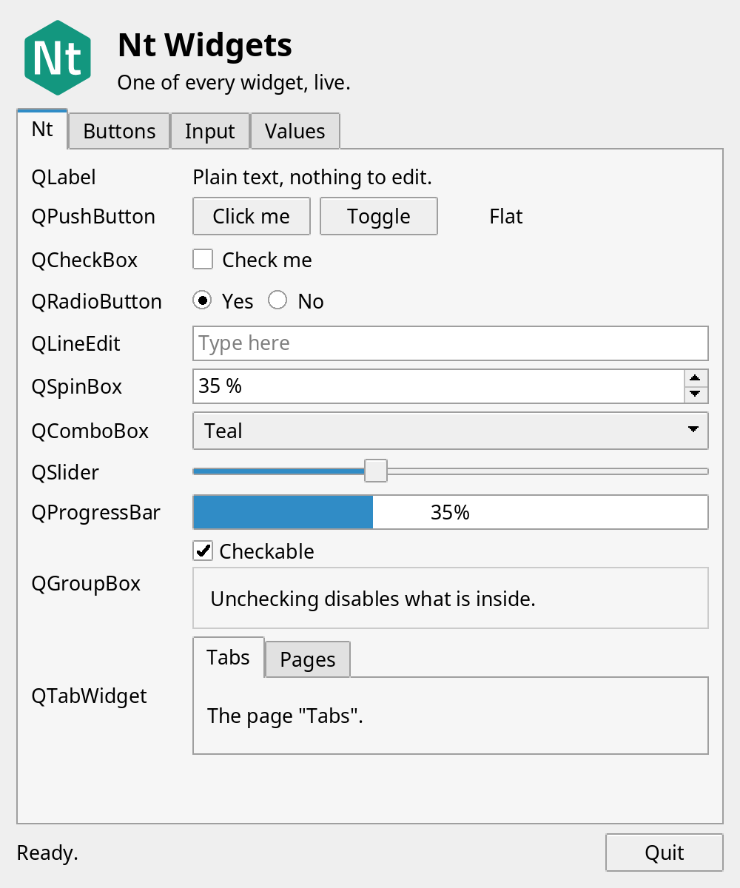
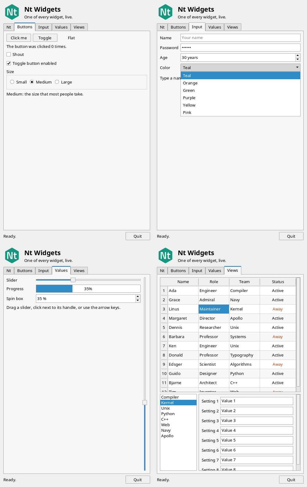
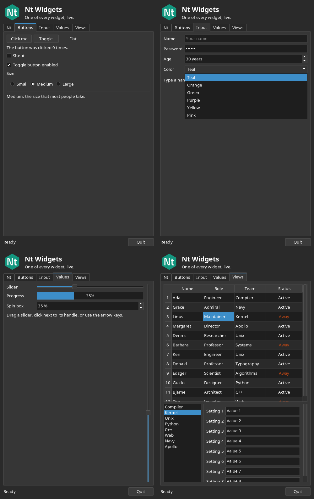
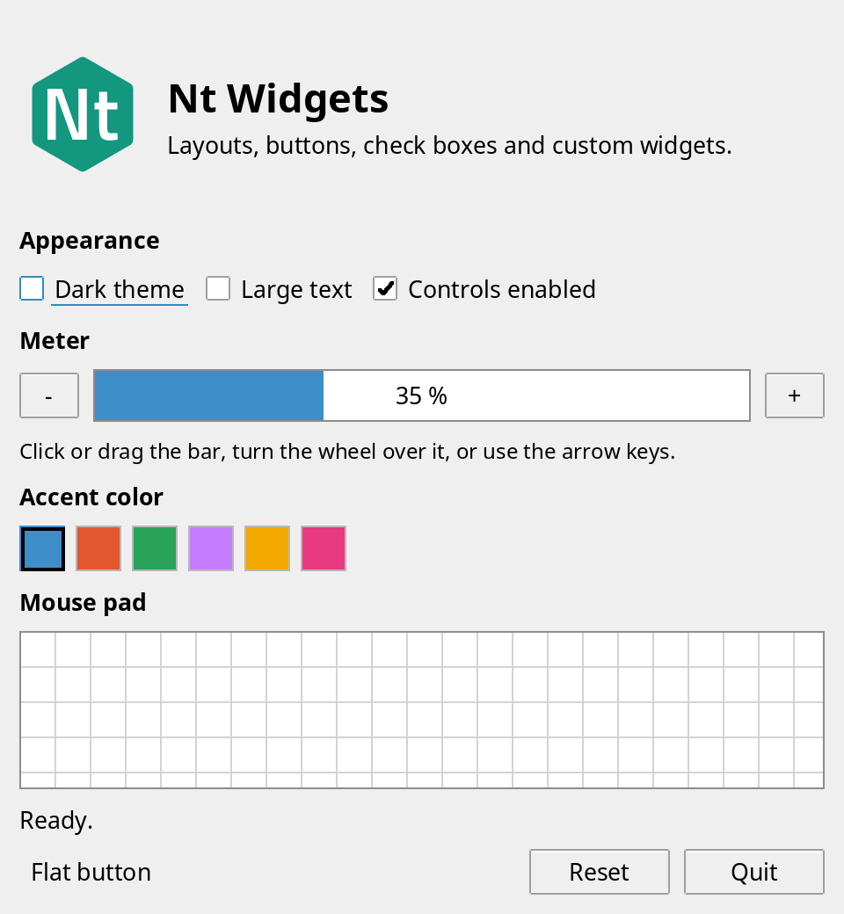
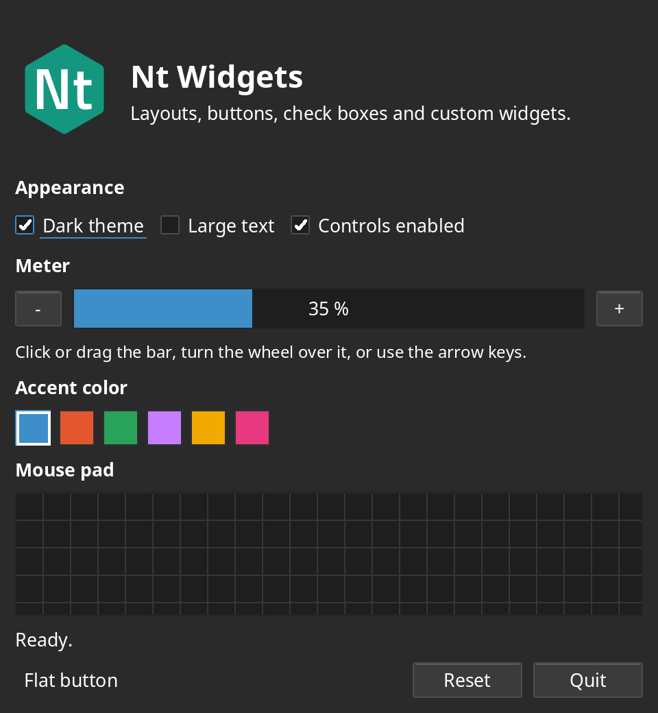

<p align="center"></p>

<p align="center"><a href="https://open-nt.github.io/Nt6/"></a></p>

<p align="center">

[](https://github.com/open-nt/Nt6/actions/workflows/ubuntu-22.04.yml)
[](https://github.com/open-nt/Nt6/actions/workflows/ubuntu-24.04.yml)
[](https://github.com/open-nt/Nt6/actions/workflows/ubuntu-26.04.yml)
[](https://github.com/open-nt/Nt6/actions/workflows/el9.yml)
[](https://github.com/open-nt/Nt6/actions/workflows/el10.yml)
[](https://github.com/open-nt/Nt6/actions/workflows/arch.yml)
[](https://github.com/open-nt/Nt6/actions/workflows/docs.yml)
[](https://github.com/open-nt/Nt6/actions/workflows/slsa.yml)
[](https://slsa.dev)

</p>

# Nt ("Nut")

A small, MIT-licensed, clean-room implementation of the Qt 6 API, built module by module: `Nt Core` (partial), `Nt Network` (partial), `Nt Serial Port`, `Nt D-Bus` and `Nt Test` so far. Not affiliated with The Qt Company; no Qt source code is used. Statically linked by default (`-DBUILD_SHARED_LIBS=ON` for a shared library). Linux/POSIX only for now.

**Documentation:** <https://open-nt.github.io/Nt6/>

**Branding:** logo and naming rules are in the [Nt Brand Guide](https://open-nt.github.io/Nt6/brand.html); the artwork is in [`assets/brand/`](assets/brand).

## Status

Qt Core has roughly 300 classes; Nt Core has about 100 of them, chosen first for what Nt Network needs. **Nt Core is not complete.**

### Nt Core: implemented

| Area | Classes |
|---|---|
| Object model | `QObject` (parent/child, `connect`/`disconnect` for member slots, functors and context objects, `blockSignals`, `sender()`, `deleteLater()`, `destroyed`, `objectName`, `findChild(ren)`, timers), `QMetaObject::Connection`, `qobject_cast`, `Qt::ConnectionType` (`Auto`, `Direct`, `Queued`), `QFlags`, `qOverload` |
| Events and loop | `QEvent`, `QTimerEvent`, `QEventLoop`, `QCoreApplication` (`exec`, `quit`, `postEvent`, `sendEvent`, `processEvents`, `aboutToQuit`, `qApp`), `QTimer` (incl. `singleShot`), `QSocketNotifier` (fd readiness via `poll()`) |
| Text and bytes | `QString` (UTF-16, `arg`, `split`, `number`, `toInt`/`toDouble`, UTF-8/Latin-1 conversion), `QChar`, `QLatin1Char`, `QLatin1StringView`, `QStringView`, `QByteArray` (hex, Base64, percent-encoding, number conversion), `QByteArrayView`, `QByteArrayList`, `QStringList`, `QTextStream` (UTF-8) |
| Containers | `QList`/`QVector`, `QQueue`, `QStack`, `QMap`, `QMultiMap`, `QHash`, `QMultiHash`, `QSet`, `QVarLengthArray`, `QBitArray`, `QCache`, `QContiguousCache`, `QSpan`, the Java-style iterators (`QListIterator`, `QMutableListIterator`, `QMapIterator`, `QMutableMapIterator`, `QHashIterator`, `QSetIterator`, ...) |
| Smart pointers | `QPointer`, `QScopedPointer`, `QScopedArrayPointer`, `QSharedPointer`, `QWeakPointer`, `QEnableSharedFromThis`, `QSharedData`, `QSharedDataPointer`, `QExplicitlySharedDataPointer`, `QScopeGuard`, `QScopedValueRollback`, `QSignalBlocker` |
| Threading primitives | `QAtomicInt`, `QAtomicInteger`, `QAtomicPointer`, `QMutex`, `QRecursiveMutex`, `QMutexLocker`, `QReadWriteLock`, `QReadLocker`, `QWriteLocker`, `QWaitCondition`, `QSemaphore`, `QSemaphoreReleaser` |
| Time and diagnostics | `QElapsedTimer`, `QDeadlineTimer`, `QBasicTimer`, `QDate`, `QTime`, `QDateTime` (UTC, local time and fixed offsets), `QDebug`, `qDebug()`/`qInfo()`/`qWarning()`/`qCritical()`/`qFatal()`, `qInstallMessageHandler` |
| I/O and file system | `QIODevice`, `QIODeviceBase`, `QBuffer`, `QFileDevice`, `QFile`, `QDataStream` (Qt's wire format), `QFileInfo`, `QDir`, `QSaveFile`, `QTemporaryFile`, `QTemporaryDir`, `QStandardPaths` (XDG) |
| Geometry | `QPoint`/`QPointF`, `QSize`/`QSizeF`, `QRect`/`QRectF`, `QLine`/`QLineF`, `QMargins`/`QMarginsF` |
| Utilities | `QUuid`, `QVersionNumber`, `QRandomGenerator`, `QCryptographicHash` (MD4, MD5, SHA-1, SHA-2, SHA-3, Keccak), `QMessageAuthenticationCode`, `QCommandLineParser`, `QCommandLineOption` |

Known limits: `QTextStream` reads and writes UTF-8 only and `QDataStream` has no transactions or 64-bit container sizes; `QDir` name filters are case-insensitive and `QFileInfo` has no birth time; `QDateTime` has no `QTimeZone` (only local time, UTC and fixed offsets); `QChar` case mapping and classification cover ASCII, Latin-1, Latin Extended-A, Greek and Cyrillic only; `QList<bool>` is rejected at compile time; all `QObject`s must be used from one thread (only `postEvent` is thread-safe); no `QMetaObject` introspection, properties or `SIGNAL()`/`SLOT()` strings.

### Nt Core: not implemented yet

- **Text:** `QAnyStringView`, `QUtf8StringView`, `QStringConverter`/`QStringEncoder`/`QStringDecoder`, `QStringMatcher`, `QStringTokenizer`, `QLocale`, `QCollator`, `QTextBoundaryFinder`, `QRegularExpression` (+ match classes), `QTranslator`, `QStringListModel`
- **Containers:** `QKeyValueIterator`
- **Variant and meta:** `QVariant`, `QMetaType`, `QMetaObject` introspection, `QMetaProperty`/`QMetaMethod`/`QMetaEnum`/`QMetaClassInfo`, `QProperty` and bindable properties, `QTypeRevision`, `QSequentialIterable`/`QAssociativeIterable`, `QObjectCleanupHandler`, `QSignalMapper`
- **Date and time:** `QTimeZone`, `QCalendar`, `QChronoTimer`, `QTimeLine`
- **File system:** `QDirIterator`, `QDirListing`, `QLockFile`, `QFileSystemWatcher`, `QFileSelector`, `QStorageInfo`, `QResource`, `QSettings`
- **Processes and plugins:** `QProcess`, `QProcessEnvironment`, `QLibrary`, `QPluginLoader`, `QSharedMemory`, `QSystemSemaphore`
- **Formats:** `QJsonValue`/`QJsonObject`/`QJsonArray`/`QJsonDocument`, `QCbor*`, `QXmlStreamReader`/`QXmlStreamWriter` (+ helpers), `QMimeDatabase`/`QMimeType`/`QMimeData`
- **Concurrency:** `QThread` (and per-thread event loops / cross-thread queued signals), `QThreadPool`, `QRunnable`, `QThreadStorage`, `QFuture`/`QPromise`/`QFutureWatcher`/`QFutureSynchronizer`, `QException`, `QEventLoopLocker`, `QAbstractEventDispatcher`
- **Item models:** `QAbstractItemModel`, `QAbstractListModel`, `QAbstractTableModel`, `QAbstractProxyModel`, `QSortFilterProxyModel`, `QIdentityProxyModel`, `QConcatenateTablesProxyModel`, `QTransposeProxyModel`, `QModelIndex`, `QPersistentModelIndex`, `QItemSelection*`, `QRangeModel`
- **Animation:** `QAbstractAnimation`, `QVariantAnimation`, `QPropertyAnimation`, `QPauseAnimation`, `QSequentialAnimationGroup`, `QParallelAnimationGroup`, `QAnimationGroup`, `QEasingCurve`
- **System and misc:** `QSysInfo`, `QOperatingSystemVersion`, `QLibraryInfo`, `QLoggingCategory`, `QMessageLogger`, `QChildEvent`, `QDynamicPropertyChangeEvent`, `QDebugStateSaver`, `QGlobalStatic`, `QBEInteger`/`QLEInteger`, `qfloat16`, `QPartialOrdering`, permission classes, JNI and Windows-only classes

### Nt Network: implemented

| Class | Notes |
|---|---|
| `QHostAddress` | IPv4/IPv6 parse and format, special addresses (`Any` is dual-stack), `isEqual` with conversion modes, loopback/multicast/link-local/global checks |
| `QAbstractSocket` | state machine, `connectToHost` (IP or name), `bind`, `disconnectFromHost` (flushes pending writes first), buffered async I/O through the event loop, `waitFor*` blocking API, read-buffer limit, socket options, `errorOccurred`, `stateChanged`, `hostFound` |
| `QTcpSocket` | client and accepted-connection sockets |
| `QTcpServer` | `listen`, `newConnection`, `nextPendingConnection`, `waitForNewConnection`, pause/resume accepting, pending-connection limit |
| `QUdpSocket` | `bind`, `writeDatagram`, `readDatagram`, `receiveDatagram`, connected mode, IPv4/IPv6 multicast join/leave |
| `QNetworkDatagram` | data, sender, destination, `makeReply` |
| `QHostInfo` | blocking `fromName`, asynchronous `lookupHost` (functor, with optional context object), `abortHostLookup`, local host and domain names |
| `QNetworkInterface`, `QNetworkAddressEntry` | list interfaces, flags, type, MTU, hardware address, addresses, netmask, broadcast (Linux) |
| `QLocalSocket`, `QLocalServer` | Unix domain sockets: event-driven and `waitFor*` APIs, access options, stale-socket recovery |
| `QNetworkAccessManager`, `QNetworkRequest`, `QNetworkReply` | HTTP/1.1 client: `GET`/`HEAD`/`POST`/`PUT`/`DELETE`/custom verbs, chunked and fixed-length bodies, redirects with policies, inactivity timeouts, Basic auth from the URL |

Differences from Qt: `QAbstractSocket::connectToHost` resolves names synchronously, although `QNetworkAccessManager` and `QHostInfo::lookupHost` do not block; `QUdpSocket` does not report the destination address or hop limit of received datagrams.

### Nt Network: not implemented yet

`QDnsLookup`, `QNetworkProxy`, `QSslSocket` and the TLS classes (so no `https:` yet), `QSctpSocket`, `QAuthenticator`, `QNetworkCookie`/`QNetworkCookieJar`, `QHttpMultiPart`, HTTP/2, connection reuse and response compression.

### Nt D-Bus: implemented

Nt D-Bus implements the D-Bus wire protocol itself (no libdbus) and works with `dbus-daemon`, `dbus-broker`, GDBus and sd-bus peers.

| Class | Notes |
|---|---|
| `QDBusConnection` | session, system and activation buses, named connections, peer-to-peer, blocking (`Block`, `BlockWithGui`), asynchronous and callback calls, `registerObject` with all export options and child objects, `registerVirtualObject`, `registerService`, signal connections with argument and signature matching; thread-safe, with one I/O thread for all connections |
| `QDBusAbstractAdaptor`, `QDBusContext`, `QDBusVirtualObject` | exported interfaces with automatic signal relay, delayed and error replies, objects that handle whole sub-trees; `Introspectable`, `Properties` and `Peer` are answered for every object |
| `QDBusAbstractInterface`, `QDBusInterface`, `QDBusConnectionInterface` | proxies with typed methods and relayed signals, remote properties, argument conversion from introspection data, the bus daemon's own interface |
| `QDBusMessage`, `QDBusArgument`, `QDBusMetaType`, `QDBusVariant`, `QDBusObjectPath`, `QDBusSignature`, `QDBusUnixFileDescriptor`, `QDBusError` | the full type system including structures, maps, variants and file-descriptor passing; custom types with `qDBusRegisterMetaType`; every received message is validated |
| `QDBusReply`, `QDBusPendingCall`, `QDBusPendingCallWatcher`, `QDBusPendingReply` | typed replies with signature checks; `QDBusPendingReply` is variadic |
| `QDBusServer`, `QDBusServiceWatcher` | a peer-to-peer server (`EXTERNAL`, optional `ANONYMOUS`), watching names including `org.example.*` wildcards |

Guide: [Using Nt D-Bus](https://open-nt.github.io/Nt6/nt-dbus.html). The [`dbus_clock`](examples/dbus/clock.cpp) example exports a clock on the session bus (`dbus_clock server`) and calls it (`dbus_clock client`).

Differences from Qt: only `unix:` addresses (no `tcp:`, `nonce-tcp:` or `autolaunch:`), and no `DBUS_COOKIE_SHA1` authentication; `QDBusInterface` has no meta-object built from introspection, so connect to remote signals with `QDBusConnection::connect()`; no `qdbusxml2cpp`, `qdbuscpp2xml`, `qdbus` or `qdbusviewer` tools.

```cpp
QTcpServer server;
server.listen(QHostAddress::LocalHost, 0);
QObject::connect(&server, &QTcpServer::newConnection, [&] {
    QTcpSocket *s = server.nextPendingConnection();
    QObject::connect(s, &QIODevice::readyRead, [s] { s->write(s->readAll().toUpper()); });
});
```

Header names match Qt: `#include <QObject>`, `#include <QtCore/QTimer>`, `#include <QtNetwork/QTcpSocket>`, `#include <QtCore/qobject.h>`.

### Nt GUI: implemented

Nt GUI is layered like Qt GUI: a `QGuiApplication` loads a platform integration (QPA), which creates the windows and delivers input. The platforms are `xcb` (X11, including XWayland) and `offscreen` (no display, for tests); pick one with `-platform` or `QT_QPA_PLATFORM`.

| Class | Notes |
|---|---|
| `QGuiApplication`, `QScreen` | platform selection, screens, focus window, keyboard modifiers and mouse buttons, `quitOnLastWindowClosed` |
| `QWindow`, `QBackingStore` | top-level windows: geometry, title, show/hide/close, expose, `requestUpdate`, mouse, wheel, key, focus, enter/leave, move, resize and close events |
| `QPaintDeviceWindow`, `QRasterWindow` | windows you paint on with `QPainter`, repainted from the event loop |
| `QPainter`, `QPaintDevice`, `QPaintEngine` | software raster engine: pen, brush, opacity, clipping, translation, composition modes; rectangles, lines, points, ellipses, images and text, without antialiasing of shapes |
| `QFont`, `QFontMetrics` | families found with fontconfig, point or pixel size, weight, italic; metrics, `elidedText()`, `drawText()` with alignment, word wrap and clipping; glyphs are anti-aliased by FreeType |
| `QImage`, `QColor`, `QRgb`, `QPen`, `QBrush`, `QRegion` | 32-bit images (`RGB32`, `ARGB32`, `ARGB32_Premultiplied`) with implicit sharing, colors with `#rgb` and CSS names, solid pens and brushes, rectangle-list regions |
| `QMouseEvent`, `QWheelEvent`, `QKeyEvent`, `QFocusEvent`, `QEnterEvent`, `QPaintEvent`, `QExposeEvent`, `QResizeEvent`, `QMoveEvent`, `QShowEvent`, `QHideEvent`, `QCloseEvent` | the event classes, with the `Qt::Key`, `Qt::MouseButton` and `Qt::KeyboardModifier` enums |

Guide: [Using Nt GUI](https://open-nt.github.io/Nt6/nt-gui.html). The [`hello_window`](examples/gui/hello_window.cpp) example paints a window and follows the mouse.

Not implemented yet: text shaping (HarfBuzz) and font fallback, `QFontDatabase`, `QTextLayout`, `QPixmap`, `QTransform`, paths and gradients, antialiasing, the clipboard, cursors, RandR multi-screen, and Wayland.

### Nt Widgets: implemented

Nt Widgets builds on Nt GUI. The widgets of a window are painted into the backing store of one native window, so only top-level widgets are `QWindow`s.

| Class | Notes |
|---|---|
| `QApplication` | the style, the default palette, top-level widgets, `activeWindow()`, `focusWidget()`, `closeAllWindows()` |
| `QWidget` | parent/child tree, geometry and size limits, size hints and policies, show/hide/enable, palette and font inheritance, painting with `update()`/`repaint()`, mouse (grab, enter/leave, tracking), wheel, key and focus events with propagation to the parent, click and tab focus, `mapTo*()`, `childAt()`, `raise()`/`lower()`, layouts |
| `QLayout`, `QBoxLayout`, `QHBoxLayout`, `QVBoxLayout`, `QLayoutItem`, `QWidgetItem`, `QSpacerItem` | box layouts with stretch factors, spacing, margins, nested layouts, alignment across the box, reversed directions, stretches and spacers; laid out again from the event loop when a size hint changes |
| `QSizePolicy` | the Qt policies |
| `QLabel`, `QPushButton`, `QCheckBox`, `QRadioButton`, `QAbstractButton` | text with alignment and word wrap; clicked/pressed/released/toggled, checkable and flat buttons, mouse and Space/Return handling; radio buttons that share a parent are exclusive, and the arrow keys move the choice |
| `QLineEdit` | one line of text: typing, cursor and selection with keys and mouse, placeholder, password and no-echo modes, maximum length, read-only, `textChanged`/`textEdited`/`returnPressed`/`editingFinished` |
| `QSlider`, `QProgressBar`, `QSpinBox` | a handle to drag (click for a page, keys, wheel, tracking, horizontal or vertical), a bar with a text format (`%p`, `%v`, `%m`), and an integer to type or step with a prefix, a suffix and wrapping |
| `QComboBox` | items to choose from a list that drops down inside the window, above or below the box; keys and wheel change the item without opening it |
| `QGroupBox`, `QTabWidget` | a titled frame, optionally with a check box that enables its children; pages with a row of tabs |
| `QGridLayout` | a grid of rows and columns with spans, stretch factors, minimum sizes, alignment and separate horizontal and vertical spacing; shares its algorithm with the box layouts, so the sizes match Qt's |
| `QFormLayout`, `QStackedLayout`, `QStackedWidget` | a form of labels and fields with the Fusion defaults (growing fields, labels on the left), wrapping of rows, row insertion and removal; pages of which one is shown, with `currentChanged`/`widgetRemoved` |
| `QFrame`, `QScrollBar`, `QAbstractScrollArea`, `QScrollArea` | box, panel, line and styled frames with a shadow; a scroll bar (handle, page click, wheel); a base class with a viewport, two scroll bars and margins; a scrolling view of a widget, resizable or not, with `ensureVisible()` |
| `QListWidget`, `QListWidgetItem`, `QAbstractItemView` | a list of text items with single, multi, extended (Control and Shift) and no selection, keys (arrows, Page, Home, End, Space, Return, type-ahead), sorting, colors, alignment, tool tips and scrolling; the base class has the selection mode and the alternating row colors that the table shares |
| `QTableWidget`, `QTableWidgetItem`, `QHeaderView` | a table of items with text, alignment, colors, font and a tool tip; row and column headers whose sections the user can resize; a current cell (click and keys), scrolling, alternating row colors, grid lines, inserting and removing rows and columns |
| `QToolTip`, `QHelpEvent`, `QWidget::setToolTip()` | tool tips that appear after the mouse rests, follow the widget under the mouse, and show the text of the nearest widget that has one; `QEvent::ToolTip` for tool tips that depend on the position |
| `QStyle`, `QStyleOption` and its subclasses, `QPalette` | a Fusion-like default style behind `QStyle`, with a light and a dark palette, replaceable with `QApplication::setStyle()` |

Guide: [Using Nt Widgets](https://open-nt.github.io/Nt6/nt-widgets.html). The [`hello_widgets`](examples/widgets/hello_widgets.cpp) example has the Nt logo and one of every widget on the pages of a tab widget (its first page, *Nt*, is a showcase of all the widgets, live, and the *Views* page has a table, a list and a scroll area), and [`gallery`](examples/widgets/gallery.cpp) shows more: custom widgets, a dark theme, enabling groups of controls, and the Nt logo drawn from its outlines.

<p align="center">  </p>
<p align="center"> </p>

The examples follow the desktop: it uses twice as many pixels on a high-resolution screen (`QScreen::devicePixelRatio()`, from `Xft.dpi` or `QT_SCALE_FACTOR`) and the dark or light colors of the desktop (`QStyleHints::colorScheme()`, read from the desktop portal). The widget examples use only API that Qt has too, so `-DNT_EXAMPLES_QT=ON` also builds them against Qt 6 (`hello_widgets_qt`, `gallery_qt` in `qt-examples/`) to compare the two side by side.

Not implemented yet: multi-line text widgets, the clipboard, the model/view classes (lists, trees, editing and sorting of tables), menus, dialogs, shortcuts and actions, window flags and attributes, cursors, `QStyleFactory`, style sheets.

## Qt 6 modules and their Nt names

The library is called **Nt**, not Qt: modules are `Nt Core`, `Nt Network`, and so on, and CMake targets are `Nt::<Module>` (`Nt::Core`, `Nt::Network`, `Nt::Gui` and `Nt::Widgets` today). The C++ API keeps Qt's class names and headers (`QObject`, `<QtCore/QTimer>`) so Qt code compiles unchanged; `Qt6::Core` remains as an alias of `Nt::Core`.

✔ = Nt has a version (partial unless noted). Blank = not started. Module list checked against the Qt 6 module overview.

### Essentials

| Qt module | Nt library | Done |
|---|---|---|
| Qt Core | Nt Core | ✔ (partial, see Status) |
| Qt D-Bus | Nt D-Bus | ✔ (see Status) |
| Qt GUI | Nt GUI | ✔ (partial, see Status) |
| Qt Network | Nt Network | ✔ (partial, see Status) |
| Qt Qml | Nt Qml |  |
| Qt Qml Core | Nt Qml Core |  |
| Qt Qml WorkerScript | Nt Qml WorkerScript |  |
| Qt Qml Models | Nt Qml Models |  |
| Qt Quick | Nt Quick |  |
| Qt Quick Controls | Nt Quick Controls |  |
| Qt Quick Dialogs | Nt Quick Dialogs |  |
| Qt Quick Layouts | Nt Quick Layouts |  |
| Qt Quick Test | Nt Quick Test |  |
| Qt Test | Nt Test |  |
| Qt Widgets | Nt Widgets | ✔ (partial, see Status) |

### Add-ons

| Qt module | Nt library | Done |
|---|---|---|
| Qt Active Qt | Nt Active Qt |  |
| Qt Bluetooth | Nt Bluetooth |  |
| Qt Canvas Painter | Nt Canvas Painter |  |
| Qt CoAP | Nt CoAP |  |
| Qt Concurrent | Nt Concurrent |  |
| Qt Graphs | Nt Graphs |  |
| Qt GRPC | Nt GRPC |  |
| Qt Help | Nt Help |  |
| Qt HTTP Server | Nt HTTP Server |  |
| Qt Image Formats | Nt Image Formats |  |
| Qt Lottie Animation | Nt Lottie Animation |  |
| Qt MQTT | Nt MQTT |  |
| Qt Multimedia | Nt Multimedia |  |
| Qt Network Authorization | Nt Network Authorization |  |
| Qt NFC | Nt NFC |  |
| Qt OPC UA | Nt OPC UA |  |
| Qt OpenGL | Nt OpenGL |  |
| Qt Positioning | Nt Positioning |  |
| Qt Print Support | Nt Print Support |  |
| Qt Protobuf | Nt Protobuf |  |
| Qt Qml Compiler | Nt Qml Compiler |  |
| Qt Qml Design Support | Nt Qml Design Support |  |
| Qt Qml Network | Nt Qml Network |  |
| Qt Qml XmlListModel | Nt Qml XmlListModel |  |
| Qt Quick 3D | Nt Quick 3D |  |
| Qt Quick 3D Physics | Nt Quick 3D Physics |  |
| Qt Quick Effects | Nt Quick Effects |  |
| Qt Quick Particles | Nt Quick Particles |  |
| Qt Quick Timeline | Nt Quick Timeline |  |
| Qt Quick Widgets | Nt Quick Widgets |  |
| Qt Remote Objects | Nt Remote Objects |  |
| Qt SCXML | Nt SCXML |  |
| Qt Sensors | Nt Sensors |  |
| Qt Serial Bus | Nt Serial Bus |  |
| Qt Serial Port | Nt Serial Port |  |
| Qt Shader Tools | Nt Shader Tools |  |
| Qt Spatial Audio | Nt Spatial Audio |  |
| Qt SQL | Nt SQL |  |
| Qt State Machine | Nt State Machine |  |
| Qt SVG | Nt SVG |  |
| Qt TextToSpeech | Nt TextToSpeech |  |
| Qt UI Tools | Nt UI Tools |  |
| Qt Virtual Keyboard | Nt Virtual Keyboard |  |
| Qt Wayland Compositor | Nt Wayland Compositor |  |
| Qt WebChannel | Nt WebChannel |  |
| Qt WebSockets | Nt WebSockets |  |
| Qt WebView | Nt WebView |  |
| Qt XML | Nt XML |  |
| Qt 5 Compatibility APIs: Graphical Effects | Nt 5 Compatibility APIs: Graphical Effects |  |
| Qt 5 Core Compatibility APIs | Nt 5 Core Compatibility APIs |  |

### Add-ons in technology preview

| Qt module | Nt library | Done |
|---|---|---|
| Qt Labs Platform | Nt Labs Platform |  |
| Qt Labs StyleKit | Nt Labs StyleKit |  |
| Qt Location | Nt Location |  |
| Qt OpenAPI | Nt OpenAPI |  |
| Qt TaskTree | Nt TaskTree |  |

### Deprecated add-ons

| Qt module | Nt library | Done |
|---|---|---|
| Qt 3D | Nt 3D |  |
| Qt Charts | Nt Charts |  |
| Qt Data Visualization | Nt Data Visualization |  |

### Extension modules

| Qt module | Nt library | Done |
|---|---|---|
| Qt PDF | Nt PDF |  |
| Qt WebEngine | Nt WebEngine |  |

### Commercial modules

| Qt module | Nt library | Done |
|---|---|---|
| Qt Insight Tracker | Nt Insight Tracker |  |
| Qt VNC Server | Nt VNC Server |  |

## ntmoc: MIT moc replacement

Qt's moc is not used. `ntmoc` (`tools/ntmoc`) is a small MIT scanner that generates the bodies of signals declared without one:

```cpp
class Counter : public QObject {
    Q_OBJECT
public:
    void setValue(int v) { emit valueChanged(v); }
signals:
    void valueChanged(int value);   // body generated by ntmoc
};
```

It handles namespaces, nested classes, overloaded signals (use `qOverload`), default arguments and unnamed parameters. Signals with a hand-written body (`{ emitSignal(&Counter::valueChanged, value); }`) also work without ntmoc. Limitations: classes must have `Q_OBJECT`; signals of template classes are not supported; parameter names are guessed by a heuristic, not a C++ parser.

### CMake

AUTOMOC, driven by ntmoc (see `examples/moc`):

```cmake
add_subdirectory(Nt6)                      # or include Nt's CMakeLists.txt
add_executable(app main.cpp counter.h)
target_link_libraries(app PRIVATE Nt::Core)
nt_enable_automoc(app)                     # sets AUTOMOC and AUTOMOC_EXECUTABLE
```

Explicit form, like `qt_wrap_cpp`:

```cmake
nt_wrap_cpp(moc_sources counter.h)
add_executable(app main.cpp ${moc_sources})
```

ntmoc also accepts the moc command line CMake's AUTOMOC uses (`-o`, `-I`, `-D`, `@file`, `--output-dep-file`, `--version`), and is available as `Nt::moc` (and `Qt6::moc`).

Everything else (`signals:`, `slots:`, `emit`, `Q_OBJECT`, pointer-to-member `connect`, slots taking fewer arguments than the signal) is source compatible. Define `QT_NO_KEYWORDS` to use `Q_SIGNALS`/`Q_SLOTS`/`Q_EMIT`.

## NDoc: MIT documentation generator

Qt's qdoc is not used. `ndoc` (`tools/ndoc`) is a small MIT tool that generates Qt-style reference pages from `/*! */` comments written next to the code, in headers or source files:

```cpp
/*!
    Returns \c true if the timer is running; otherwise returns \c false.

    \sa start(), stop()
*/
bool QTimer::isActive() const { return m_id != 0; }
```

```sh
cmake --build build --target docs      # writes build/doc/html
```

The documentation is published to <https://open-nt.github.io/Nt6/> on every push to `main`.

The class pages of the widgets show how each widget is drawn, in its states, in the light color scheme. The pictures in `doc/images/widgets` come from the real widgets: `cmake --build build --target widget_images` renders them with `QWidget::render()` on the offscreen platform (no display needed), so run it again after changing how a widget or the style draws, and commit the result. The `docs` target fails on any broken link or bad parameter name. `coverage.txt` in the output lists public API that has no documentation yet. See [tools/ndoc/README.md](tools/ndoc/README.md) for the comment syntax. Write documentation from Nt's behaviour: Qt's documentation text is not MIT licensed, so it must not be copied or reworded.

## Also not supported

`SIGNAL()`/`SLOT()` string connections, `BlockingQueuedConnection`, `UniqueConnection`, and `Q_PROPERTY`/`Q_GADGET`/`Q_ENUM` (the macros compile to nothing, so `ntmoc` only generates signal bodies).

## Build

```sh
cmake -S . -B build && cmake --build build && ctest --test-dir build
```

Requires C++17 and a POSIX system. Link with `Nt::Core` and `Nt::Network` (or the `Qt6::Core` / `Qt6::Network` aliases).

## Packages

Install instructions for every system below are in the [Installing Nt](https://open-nt.github.io/Nt6/install.html) guide. CPack builds the native packages on the distribution they are for, in CI and locally:

| Distribution | Packages | Workflow |
|---|---|---|
| Ubuntu 22.04, 24.04, 26.04 | `libnt6-dev_<version>-1~ubuntu<release>_amd64.deb`, `nt6-tools_...deb` | `ubuntu-22.04.yml`, `ubuntu-24.04.yml`, `ubuntu-26.04.yml` |
| Enterprise Linux 9 and 10 (RHEL, Rocky, Alma) | `nt6-devel-<version>-1.el<N>.x86_64.rpm`, `nt6-tools-...rpm` | `el9.yml`, `el10.yml` |
| Arch Linux | `nt6-<version>-1-x86_64.pkg.tar.zst` | `arch.yml` |
| Any Linux with snapd | `nt6_<version>_amd64.snap` (`snap install nt6`) | `snap.yml` |

`libnt6-dev` / `nt6-devel` holds the headers (in `/usr/include/nt6`, so Nt can sit next to Qt), the static libraries and the CMake package; `nt6-tools` holds `ntmoc` and `ndoc`. Arch has one package with everything. In a project:

```cmake
find_package(Nt6 6 REQUIRED)
target_link_libraries(app PRIVATE Nt6::Network)   # Nt::Network works too
nt_enable_automoc(app)
```

To build the packages yourself:

```sh
packaging/build-packages.sh              # every distribution above, in Docker containers
packaging/build-packages.sh el9 arch     # some of them
packaging/build.sh                       # this machine only, no container
```

Both write to `dist/`. Or run CPack directly: `cmake -S . -B build && cmake --build build && cpack --config build/CPackConfig.cmake` picks `.deb`, `.rpm` or pacman from `/etc/os-release`; use `-G DEB`, `-G RPM` or `-G External` (pacman, through `cmake/NtPacman.cmake`) to choose.

### Release provenance

Pushing a `v*` tag runs `slsa.yml`: it builds the packages for all six systems and the snap, generates [SLSA](https://slsa.dev) level 3 provenance with the [SLSA GitHub generator](https://github.com/slsa-framework/slsa-github-generator), and attaches the packages and `multiple.intoto.jsonl` to the GitHub release, and publishes the snap to the Snap Store (the `candidate` channel for a pre-release version such as `6.1.0-rc1`, otherwise `stable`; this needs the `SNAPCRAFT_STORE_CREDENTIALS` secret, see `snap.yml`). Check a download with [slsa-verifier](https://github.com/slsa-framework/slsa-verifier):

```sh
slsa-verifier verify-artifact libnt6-dev_6.1.0-1~ubuntu24.04_amd64.deb \
    --provenance-path multiple.intoto.jsonl --source-uri github.com/open-nt/Nt6 --source-tag v6.1.0
```
